# LinkedIn Puzzle Solvers Engine

[](https://github.com/JFrusher/linkedin-puzzle-solvers/actions/workflows/ci.yml)
[](https://github.com/JFrusher/linkedin-puzzle-solvers/actions/workflows/benchmark.yml)


A Python monorepo of computer-vision parsers and solvers for LinkedIn's eight daily puzzles. It turns a
screenshot into a structured board, solves it and explains every deduction. It also draws the answer back
onto the original image.

| Game | Vision | Solver |
|---|---|---|
| **Queens** (Crowns) | LAB colour sampling + K-Means regions | Knuth's Algorithm X on Dancing Links |
| **Zip** (Pathfinder) | Hough circles + EasyOCR digits, wall-thickness probes | A* with connectivity and degree pruning |
| **Tango** (Sun & Moon) | Symbol colour (orange sun, blue moon) + ink at each edge sign's centre (× vs =) | CNF reduction solved by MiniSat (PySAT) |
| **Pinpoint** (Categories) | Text stream | Sentence-BERT moving centroid × WordNet hypernyms + word-play checks (join word, many senses) |
| **Crossclimb** (Word Ladder) | Letter-box rows + EasyOCR clues, or typed in | SBERT clue answering + Hamming-1 ladder search + shared-clue end pair |
| **Wend** (Word Partitioning) | Per-tile EasyOCR on tight crops, grey wall tiles, slot rows (same or separate screenshot), or typed in | Trie-guided DFS tiling over WordNet words and their inflections + flood-fill island pruning |
| **Mini Sudoku** (6×6) | Ink test + per-cell EasyOCR digits | CNF exactly-one encoding solved by MiniSat (PySAT) |
| **Patches** (Rectangles) | Coloured badges: a '+' badge holds the area (EasyOCR), a solid icon's aspect gives the shape | Exact cover on Dancing Links |

Solved overlays on real LinkedIn screenshots (`tests/fixtures/real/`):

| Queens | Zip | Tango |
|:---:|:---:|:---:|
| 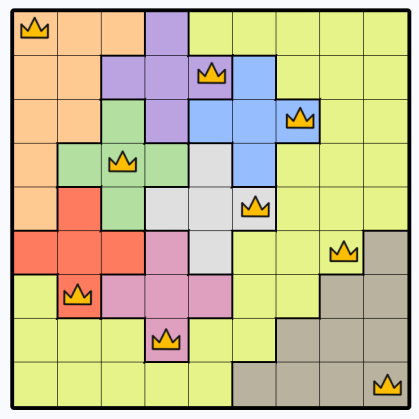 | 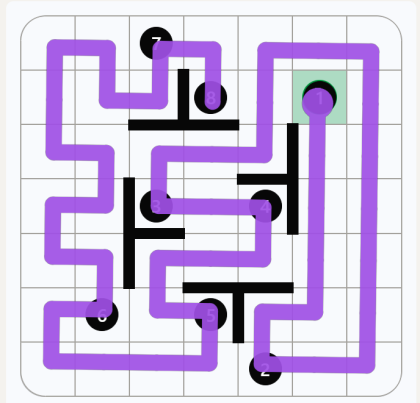 | 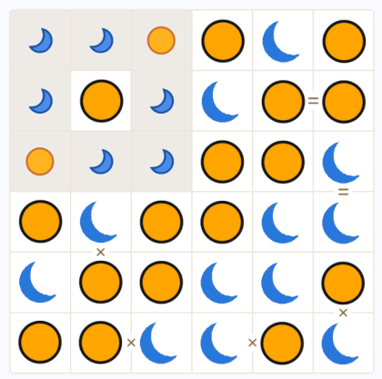 |
| **Mini Sudoku** | **Patches** | **Wend** |
| 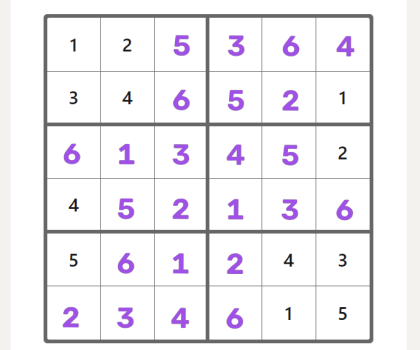 | 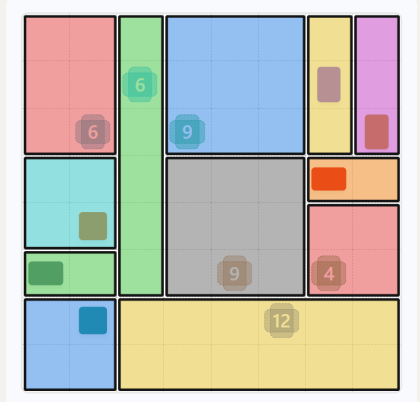 | 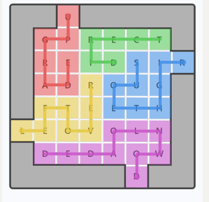 |

---

## How it works

Each animation runs one real LinkedIn screenshot through the whole pipeline. First the vision stages: find
the board, detect the grid, read the cells. Then the solver's own deduction log, replayed step by step: the
ringed cells are the ones each step decides, and red marks are cells or rectangles ruled out. Regenerate them
with `python -m bench.gifs`.

### Queens: exact cover with Dancing Links

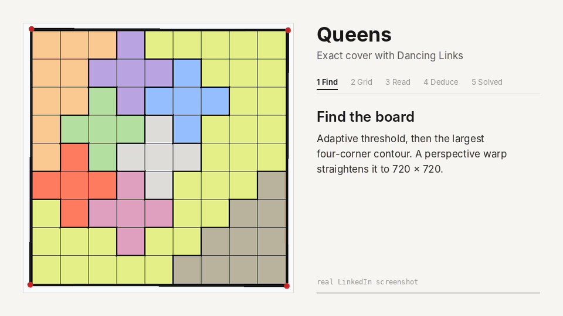

One queen per row, column and colour region, and no two queens touching: that is an exact-cover problem.
The solver runs Knuth's Algorithm X on Dancing Links, with rows, columns and regions as primary items and
every 2×2 window as a secondary item for the no-touch rule. The replay uses the rules a person would:
Single Choice, Shared Attack (every slot left in a line attacks the same cells) and Confinement (k regions
that fit inside k lines claim those lines).

### Zip: Hamiltonian path with A*

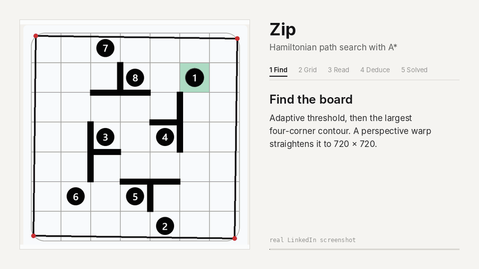

The path must visit every cell once and pass the numbers in order. A* searches over (head, visited cells,
next checkpoint); because every move costs one and the path length is fixed, the heuristic is exact on any
state that can still be finished. States are cut as soon as the unvisited cells split apart, a cut cell
(found with Tarjan's algorithm) cannot be passed, or a cell is left with fewer than two exits.

### Tango: SAT

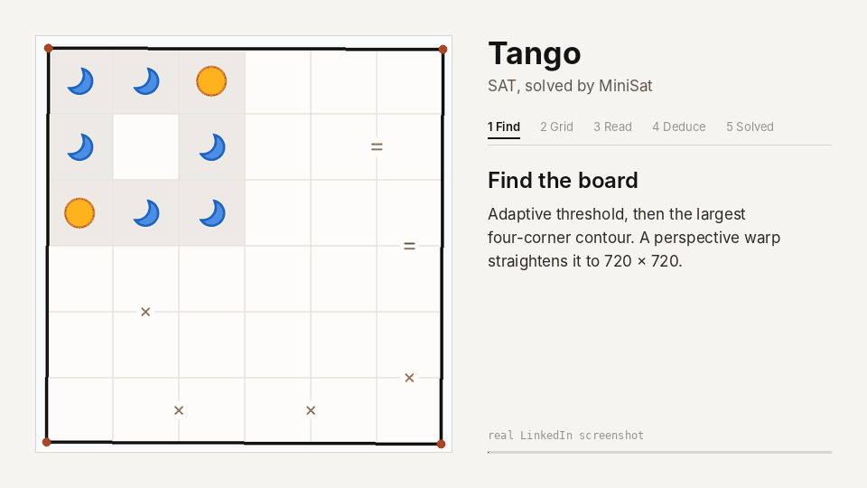

One Boolean per cell (sun or moon). Each line holds exactly three of each, encoded with sequential-counter
cardinality constraints, plus a clause pair per window of three cells and an equivalence or exclusive-or for
each = or × sign. MiniSat solves it in under a millisecond. The replay explains every cell with No Three,
Balance, Relation and Sign Balance.

### Mini Sudoku: SAT, explained with singles

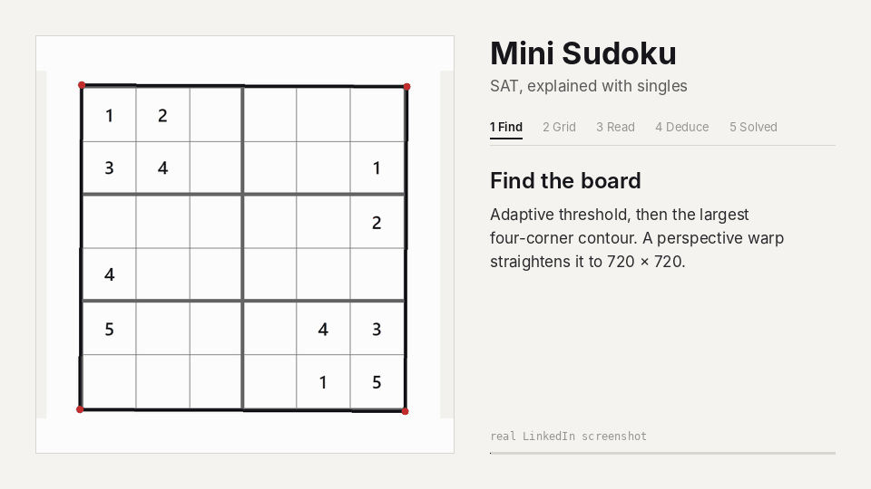

216 variables, one per cell and digit, with exactly-one clauses for every cell and for every digit in every
row, column and 2×3 box. The replay uses naked singles (one digit left for a cell) and hidden singles (one
cell left for a digit); this board needs only naked singles.

### Patches: exact cover with Dancing Links

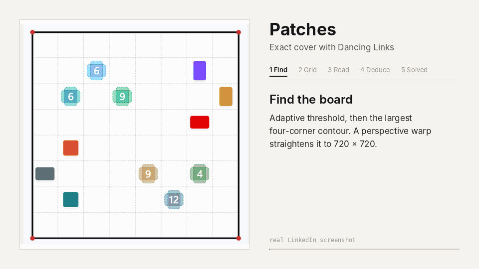

Every rectangle that fits a clue's area or shape and holds no other clue becomes a row. Its columns are the
cells it covers plus the clue itself, and Dancing Links picks rows that cover everything exactly once. The
replay uses Only Fit, Only Cover and Try and Fail: a red outline is a rectangle that leads to a dead end a
few steps later.

### Wend: trie search and exact tiling

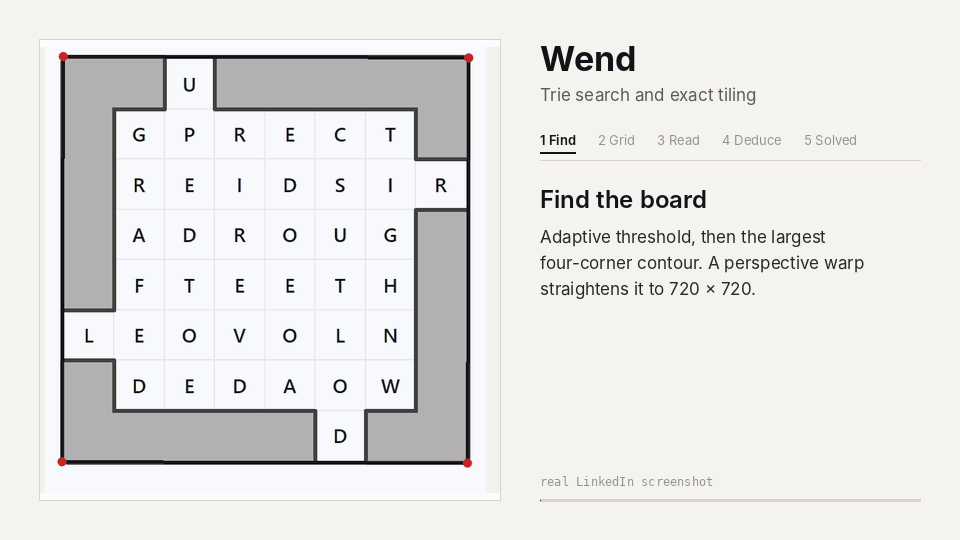

A trie of WordNet words and their inflections drives a depth-first search that lists every word path on the
board. An exact tiling then picks words of the slot lengths that cover every tile. Nook (a tile with one
open neighbour must start or end a word) and Only Word explain each placement.

### Engineering notes

How the hard parts were solved, with the numbers: [case studies](docs/case-studies/) (a misleading baseline,
Zip's long tail, rule soundness, real-screenshot calibration) and [decision records](docs/decisions/).

---

## Running it

Nothing is hosted for you: everything runs on your own computer. One Python engine reads the screenshot,
solves the puzzle and draws the answer, and you reach it through any of these:

```text
                 ┌─────────────── your computer ────────────────┐
 screenshot ───► │  Web playground  (streamlit, localhost:8501) │
 or typed board  │  Command line    (python main.py solve …)    │──► same engine:
                 │  Browser extension ──► local server :8765    │    read → solve → explain → draw
                 └──────────────────────────────────────────────┘
```

### Setup (once, Python 3.11)

```bash
git clone https://github.com/JFrusher/linkedin-puzzle-solvers && cd linkedin-puzzle-solvers
pip install torch torchvision --index-url https://download.pytorch.org/whl/cpu   # CPU build, ~2 GB smaller
pip install -r requirements.txt
python -m nltk.downloader wordnet
```

The first OCR call downloads the EasyOCR weights (GitHub) and the first Pinpoint or Crossclimb call downloads
`all-MiniLM-L6-v2` (Hugging Face); after that everything works offline.

### Paste a screenshot (the quickest way)

1. `streamlit run web_app/app.py` opens the playground at `localhost:8501` on the paste page.
2. Screenshot the board with **Win+Shift+S**.
3. Click the paste box, press **Ctrl+V**, then **Enter**. The game is detected for you.
4. Right-click the solved board → **Copy image**, and Ctrl+V it wherever you like (or use **Download PNG**).

From a terminal, the same round trip is one command: it reads the clipboard, detects the game, saves
`solved.png` and puts the solved board back on the clipboard (the copy-back is Windows only).

```bash
python main.py solve --paste
```

Detection tries Queens, Zip, Tango, Mini Sudoku, Wend and Patches in turn and keeps the first that reads and
solves the board. Each reader rejects boards that are not its game, for example Queens needs coloured
regions and Tango only orange and blue symbols, so the first success is the right one: 37 of 37 test
screenshots (6 real, 31 synthetic) are detected correctly.

### Command line

```bash
python main.py solve --image board.png                      # game detected; writes board_solved.png
python main.py solve --game zip --image zip.png --json      # name the game; machine-readable result
python main.py solve --game wend --image wend.png --slots slots.png   # Wend slots in their own screenshot
python main.py solve --game wend --text examples/wend.txt   # type the board in (Wend, Crossclimb)
python main.py stream --game pinpoint                       # type Pinpoint clues one at a time
python main.py benchmark --game all                         # latency / memory / accuracy
```

Typed boards (`--text`, or "Type the board" in the playground) skip vision for Wend and Crossclimb. Wend: one
row of letters per line, `#` for a wall, then the word lengths. Crossclimb: the word length, the shared
top/bottom clue, then the middle clues. See `examples/`.

### Web playground

`streamlit run web_app/app.py`, then pick from the sidebar: paste a screenshot (auto-detect), or choose a game
and use a synthetic sample, an uploaded screenshot or a typed board. Each run shows the solved board, the
deduction log, latency and memory, and debug views of every vision stage.

### Browser extension (solve on the LinkedIn page)

1. Start the local server and leave it running: `python main.py serve` (listens on `127.0.0.1:8765`).
2. In Chrome open `chrome://extensions`, turn on **Developer mode**, click **Load unpacked** and pick the
   `extension/` folder.
3. Open a game on `linkedin.com/games/…` and click the extension icon.

It screenshots the visible tab, sends it to your local server and draws the answer over the page; **Esc**
hides it. The badge shows `…` while working, `✓` when done, `err` on a failure and `n/a` on a page that is not
a supported game. Reload LinkedIn tabs that were open before the extension was installed. The whole board
must be on screen (for Wend, the word slots too); Pinpoint is text, so use the playground or `stream`.

### Docker (the server without installing Python)

```bash
docker build -t puzzle-solvers .
docker run -p 127.0.0.1:8765:8765 puzzle-solvers            # replaces `python main.py serve`
docker run -v "$PWD:/data" puzzle-solvers solve --image /data/board.png
```

The image bakes in every model, so containers start offline. Keep the `127.0.0.1:` prefix: the server has no
login, and a plain `-p 8765:8765` exposes it to your whole network.

### What is hosted

Only GitHub Actions: CI runs the tests on every pull request and the Benchmark workflow re-runs the timings
daily. The server answers one request at a time and has no login, so it is built for your own machine, not for
public hosting.

---

## Architecture

```text
                   ┌──────────────────────────────────────────────────────────────┐
  screenshot ───►  │ core/vision_base.py  BaseVisionParser                        │
                   │  adaptiveThreshold → findContours → largest convex quad      │
                   │  getPerspectiveTransform → 720×720 deskewed grid             │
                   │  edge-profile × line-comb correlation → N                    │
                   │  extract_cells(N) → trimmed cell crops                       │
                   └───────────────┬──────────────────────────────────────────────┘
                                   │ game parser (solvers/<game>/vision.py)
                                   ▼
                          typed, validated Board dataclass
                                   │
                   ┌───────────────▼──────────────────────────────────────────────┐
                   │ core/solver_base.py  BaseSolver.run()                        │
                   │  profile(): perf_counter_ns (µs) + tracemalloc (peak KiB)    │
                   │  solve(board) → solution | UnsolvableError                   │
                   │  nodes_expanded counter                                      │
                   └───────┬───────────────────────────────┬──────────────────────┘
                           │                               │
             ┌─────────────▼───────────┐       ┌───────────▼────────────────────┐
             │ core/explainer.py       │       │ core/visualizer.py             │
             │ "Step 2 [Single Choice]"│       │ crowns, suns/moons, ribbons    │
             │ → JSON / Markdown       │       │ BGRA layer → inverse homography│
             └─────────────────────────┘       └───────────┬────────────────────┘
                                                           ▼
        CLI (main.py) · Streamlit (web_app/) · REST (main.py serve) ◄── extension/
```

### Browser extension flow

```text
 toolbar click ─► background.js: captureVisibleTab (activeTab)
              ─► POST 127.0.0.1:8765/solve {game, image}
              ◄─ {solution, steps, profile, overlay: BGRA PNG}
              ─► content.js: full-viewport , pointer-events: none  (Esc hides)
```

The extension does not rely on LinkedIn's DOM class names. It runs the same vision pipeline on a screenshot of the viewport.

---

## Algorithms and complexity

| Game | Formulation | Worst case | In practice |
|---|---|---|---|
| Queens | Exact cover: 3N primary items (row, column, region) and (N−1)² secondary 2×2 windows encoding non-adjacency | O(N!) branches (NP-complete) | MRV column choice; ≤ N + a few nodes on generated boards |
| Zip | Hamiltonian path through ordered checkpoints; A* over (head, visited bitmask, next checkpoint) | O(4^{N²}) states (NP-complete) | f = g + max(unvisited, Manhattan chain) is exact on feasible states. Connectivity, Tarjan cut-cell and degree-2 checks cut dead ends; repeated states are expanded once |
| Tango | SAT: N² vars; sequential-counter cardinality for N/2 per line; (¬a∨¬b∨¬c)∧(a∨b∨c) per triple; ⇔ / ⊕ for signs | O(2^{N²}) | MiniSat CDCL, tens of decisions |
| Pinpoint | C = (1/K) Σ Embed(clueᵢ); score = cos(C, Embed(h)) × coverage(h) over hypernyms h | O(K · H · d) | H ≈ hundreds of hypernyms, d = 384 |
| Crossclimb | Top-25 gloss-similar words per clue; branch-and-bound best-score path in the Hamming-1 graph; then the top/bottom pair one letter from each end that best fits the shared clue | O(K! · 25^K) | Bounded by best-remaining-score; sparse graph; end pairs are tens of candidates |
| Mini Sudoku | SAT: 216 vars x(r,c,d); pairwise exactly-one per cell and per digit in every row, column and 2×3 box | O(6^{36}) | Givens propagate to the answer: MiniSat makes ~2 decisions |
| Patches | Exact cover: N² cell items + one item per clue; rows are rectangles that fit the clue's area and/or shape and hold no other clue | O(rectangles^{clues}) | MRV column choice; tens of nodes |
| Wend | Trie DFS enumerates word paths; exact tiling over tiles with MRV; islands must be subset-sum fillable | O(placements^{words}) | Trie prunes dead prefixes; flood-fill rejects untileable islands |

### Rust twin of Dancing Links

`rust/dlx/` is a Rust port of `core/dlx.py` (PyO3), with the same API and the same search order:
minimum-remaining-values column, first column wins ties, rows top to bottom. `tests/test_dlx_rust.py` checks
that the two engines yield the same covers in the same order with the same node count, on 300 random matrices
and through the real Queens and Patches solvers. The solvers stay on the Python engine, so installing needs no
Rust toolchain; the Rust one shows what the same algorithm costs without Python's object overhead.

Building the matrix and searching to exhaustion (`pip install ./rust/dlx && python -m bench.dlx_speed`):

| Case | Covers | Nodes | Python | Rust | Speed-up |
|---|---:|---:|---:|---:|---:|
| LinkedIn Queens 8×8 | 1 | 9 | 0.20 ms | 0.015 ms | 13× |
| LinkedIn Queens 12×12 | 1 | 25 | 0.73 ms | 0.041 ms | 18× |
| LinkedIn Queens, real screenshot | 1 | 112 | 1.31 ms | 0.046 ms | 28× |
| Patches, real screenshot | 1 | 16 | 0.35 ms | 0.023 ms | 15× |
| Classic 8-queens, all answers | 92 | 1,198 | 4.78 ms | 0.169 ms | 28× |
| Classic 10-queens, all answers | 724 | 16,447 | 68.38 ms | 1.995 ms | 34× |
| Classic 12-queens, all answers | 14,200 | 327,812 | 1,383 ms | 52.4 ms | 26× |

Both engines expand exactly the same nodes, so the ratio is engine speed alone. The answer counts for classic
N-queens (92, 724, 14,200) match the known values, an independent check on both. The Rust search keeps nodes
in flat index arrays and uses an explicit stack instead of recursion, which is also what lets it yield covers
lazily like the Python generator.

### Measured performance

Below is the median of 25 solves without memory tracing, plus one traced run for peak memory. It was run on a
shared cloud container with CPython 3.13. Vision ✅ means the parser recovered the hand-checked board: from a
perspective-skewed synthetic render, or from a real LinkedIn screenshot. Every board has exactly one answer,
like the real game.

| Game | Case | Vision | Solved | Median latency (µs) | Peak memory (KiB) | Nodes |
|---|---|:---:|:---:|---:|---:|---:|
| queens | 6x6 | ✅ | ✅ | 151 | 28.5 | 6 |
| queens | 8x8 | ✅ | ✅ | 282 | 50.2 | 9 |
| queens | 10x10 | ✅ | ✅ | 437 | 78.4 | 10 |
| queens | 12x12 | ✅ | ✅ | 746 | 113.0 | 12 |
| queens | real screenshot (9x9) | ✅ | ✅ | 1,074 | 63.6 | 81 |
| zip | 5x5 | ✅ | ✅ | 1,360 | 19.9 | 31 |
| zip | 6x6 | ✅ | ✅ | 1,520 | 25.9 | 36 |
| zip | 7x7 | ✅ | ✅ | 5,923 | 40.0 | 81 |
| zip | real screenshot (7x7) | ✅ | ✅ | 4,036 | 32.4 | 62 |
| tango | 6x6 seed 1 | ✅ | ✅ | 358 | 75.2 | 8 |
| tango | 6x6 seed 2 | ✅ | ✅ | 361 | 76.1 | 9 |
| tango | 6x6 seed 3 | ✅ | ✅ | 337 | 75.4 | 2 |
| tango | real screenshot (6x6) | ✅ | ✅ | 368 | 75.5 | 8 |
| wend | 5x5 sample | ✅ | ✅ | 832 | 31.3 | 368 |
| wend | real screenshot (8x8, 5 words) | ✅ | ✅ | 1,612 | 34.1 | 622 |
| mini-sudoku | 6x6 seed 1 | ✅ | ✅ | 908 | 328.2 | 2 |
| mini-sudoku | 6x6 seed 2 | ✅ | ✅ | 757 | 328.3 | 2 |
| mini-sudoku | 6x6 seed 3 | ✅ | ✅ | 758 | 328.3 | 2 |
| mini-sudoku | real screenshot | ✅ | ✅ | 759 | 328.3 | 2 |
| patches | 5x5 | ✅ | ✅ | 385 | 18.7 | 11 |
| patches | 6x6 | ✅ | ✅ | 1,062 | 32.2 | 14 |
| patches | 7x7 | ✅ | ✅ | 1,492 | 43.8 | 21 |
| patches | real screenshot (8x8) | ✅ | ✅ | 2,052 | 72.6 | 16 |

Queens meets the < 1 ms target up to 12×12 on this run (12×12: 746 µs); the real 9×9 board takes 1.1 ms
because its large yellow region leaves DLX more branching (81 nodes). Zip on sparse boards (few numbers, no
walls) is the hardest case; its numbers are in `docs/IMPROVEMENTS.md`. Pinpoint and Crossclimb latencies come
from the CI benchmark, because they need the SBERT model. The **Benchmark** workflow re-runs the whole suite
daily and publishes the table as a job summary and an artifact.

### Scaling past LinkedIn's sizes

LinkedIn ships fixed sizes, so `python -m bench.scaling` grows the seeded generators past them. It plots the
median and the worst of five boards per size:

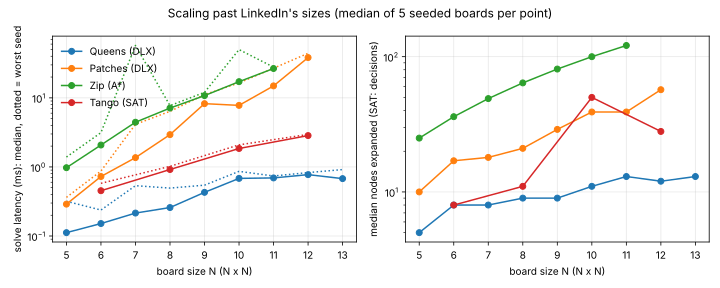

- **Queens:** DLX expands about N nodes up to 13×13 (5 at 5×5, 13 at 13×13). On a board with one answer,
  choosing the column with the fewest options almost never has to back up.
- **Patches:** grows fastest per node, because the candidate rectangles grow with the area. The median rises
  from 0.3 ms at 5×5 to about 40 ms at 12×12.
- **Zip:** the median A* run expands exactly N² nodes, so it walks straight to the goal. The tail is heavy:
  `sparse_zip(12, seed=3)` cost 3,213,205 nodes and 608 s, while seeds 0–2 took 144–721 nodes. That is why the
  chart stops at 11×11.
- **Tango:** CNF size grows with N², but MiniSat needs only 8–50 decisions up to 12×12.

---

## Explainable output

Every run returns a deduction log, rendered as Markdown in the CLI or as JSON over REST. Excerpts from the real
boards in `tests/fixtures/real/`:

```text
Queens
| 2  | Single Choice | (2,6) | Cell (2, 6) must be a Queen because Column 6 has no other valid slot
| 4  | Shared Attack | (5,8) | every slot left in Row 8 attacks [(5, 8), (6, 7), (6, 8), (7, 7), (7, 8)], so none of them can be a Queen
Tango
| 9  | No Three      | (1,1) | Cell (1, 1) must be sun because (1, 0) and (1, 2) are both moon
| 12 | Sign Balance  | (1,4) | Cell (1, 4) must be sun because its = pair with (1, 5) needs two matching symbols but the line has room for 1 more moon
| 17 | Balance       | (4,2) | Cell (4, 2) must be sun because its line already holds 3 moons
Patches
| 1  | Only Fit      | (6,5) | clue 12 at (6, 5) takes the 2x6 patch at (6, 2) because it is the only rectangle left that fits the clue
| 5  | Try and Fail  | (1,2) | clue 6 at (1, 2) cannot take the 2x3 patch at (0, 2): a few steps later a clue has no rectangle or a cell cannot be covered
```

Queens, Tango, Wend, Mini Sudoku and Patches replay the solution with human rules (single choice, relations,
no-three, balance, naked and hidden singles, only fit, only cover, try and fail). They label a step `Search` or `SAT`
only when no single rule forces the move.

### Difficulty

Those five games also get a difficulty, read off the log the way Sudoku graders rate puzzles: a board is as hard
as the hardest rule it needs, and how often that rule fires orders boards within a band (`core/difficulty.py`).

| Band | Rules |
|---|---|
| Easy | Single Choice, No Three, Relation, Balance, Naked Single, Only Fit, Only Word, Nook |
| Medium | Shared Attack, Confinement, Sign Balance, Equal Pair Neighbour, Hidden Single, Only Cover |
| Hard | Try and Fail |
| Expert | Search, SAT (no rule applies) |

The real boards in `tests/fixtures/real/` rate as follows:
- Queens: `Medium: Confinement ×1, Shared Attack ×1`
- Tango: `Medium: Sign Balance ×3`
- Mini Sudoku: `Easy: Naked Single ×24`
- Patches: `Hard: Try and Fail ×2`
- Wend: `Easy: Only Word ×3, Nook ×2`

The CLI, the JSON output and the paste page show the rating.

---

## Repository layout

```text
rust/dlx/      Rust twin of core/dlx.py (PyO3), checked equal by tests, benchmarked by bench/dlx_speed.py
core/          vision_base · solver_base · explainer · visualizer · dlx · nlp (SBERT + WordNet)
solvers/       queens · zip · tango · pinpoint · crossclimb · wend · sudoku · patches  (+ registry in __init__)
bench/         benchmark_runner · synthetic (seeded generators + skewed renderers) · real (screenshot boards) · gifs · scaling
tests/         one suite per game + core, real screenshots (fixtures/real), typed boards, animations
web_app/       Streamlit playground (sample, upload or typed board · Raw · Contours · HSV Masks · Graph Nodes tabs)
extension/     Manifest V3: background.js (capture + REST) · content.js (overlay)
main.py        CLI: solve · stream · benchmark · serve
examples/      typed boards for --text (Wend, Crossclimb)
docs/          case-studies · decisions · IMPROVEMENTS.md (measurements) · overlays · GIFs · social preview
```

---

## Scope and limitations

- **Calibrated on one real screenshot per game** (`tests/fixtures/real/`, boards in `bench/real.py`) and on
  seeded synthetic renders that copy the real look. Every threshold quotes the real and synthetic values it
  separates. Crossclimb and Pinpoint have no real capture yet, so the Crossclimb layout is still a guess.
- **Crossclimb** assumes each clue is printed to the left of its row of letter boxes. It answers clues from
  WordNet glosses, so trivia outside WordNet's vocabulary is out of reach.
- **Wend** words use orthogonal adjacency. Inflections (DOWNLOADED, CARRIED) are generated by English
  spelling rules and kept only when WordNet maps them back to a lemma, so a few odd forms of mass nouns
  ("wealths") get in. Without the word lengths the solver finds *a* tiling, not necessarily the intended one:
  pass `--slots` when the slot rows are not in the board screenshot, or type the board with its lengths.
  The REST server takes one image.
- **Zip** uses A* with backtracking order and pruning. It does not use a bidirectional search.
